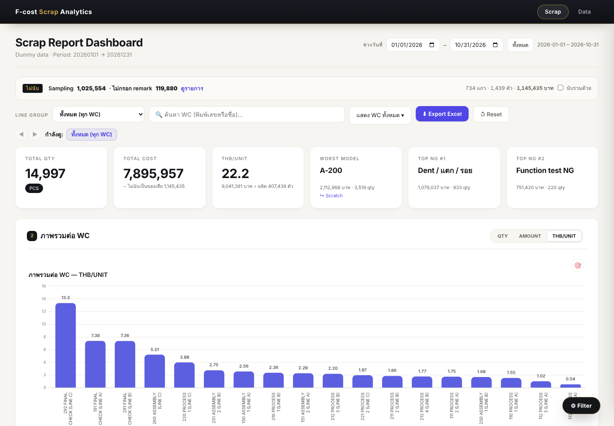

# F-cost Scrap Analytics

**[▶ Open the live dashboard](https://napongphant.github.io/fcost-scrap-analytics/)**

An interactive scrap-cost dashboard I built for my job as a process engineer in a
manufacturing plant. At work it replaced about **a day a week** of making Pareto
charts by hand. The version here runs on **randomly generated data** for a made-up
factory with three products (A, B, C).

[](https://napongphant.github.io/fcost-scrap-analytics/)

## The problem

Every scrapped part is logged with a free-text remark typed by an operator:

```
Scratch = 2, Dent = 1
Wrong size
น็อตหลวม
Scrach = 3
Daily QC sampling
```

One cell can hold several causes, the same cause is spelled many ways, some rows are
QC sampling that should not count as scrap, and cost means little until it is divided
by how many units the line finished.

## What the tool does

1. **Parses each remark** into cause, quantity and cost, including several causes in one cell.
2. **Merges spellings** of the same cause into one group.
3. **Groups causes** into the categories QC reports on.
4. **Leaves out non-scrap rows** such as QC sampling, with a switch to count them back in.
5. **Joins daily production** so charts can show **THB per unit produced**, not only total cost.
6. **Builds an interactive dashboard** with filters by line, work center, date, unit and model;
   Pareto by work center and by cause; monthly trend; cause × day pivot; part ranking;
   merging causes in the browser; and Excel export.

## Built with

Python (pandas, regular expressions) to process the data · HTML / CSS / JavaScript with
Chart.js for the dashboard. Developed with an AI coding assistant (Claude); I designed the
logic and business rules and checked the results against QC's reports.

## Source code

The Python processing code is not public because it was developed for my employer.
I'm happy to walk through it in an interview.

---

All rights reserved. Shared for portfolio viewing only.
